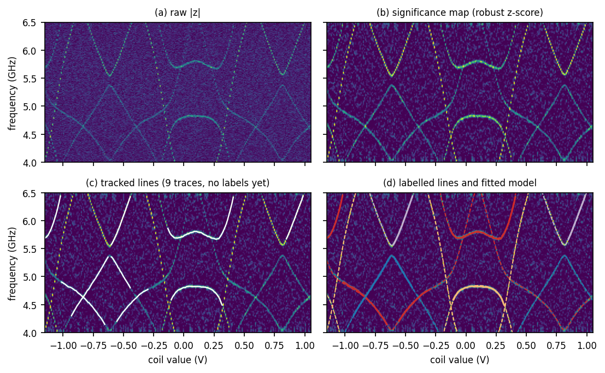
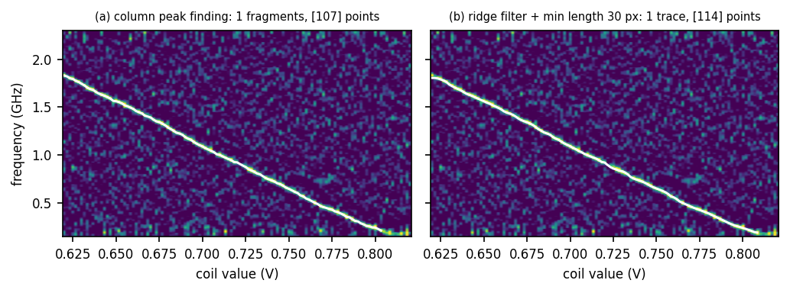
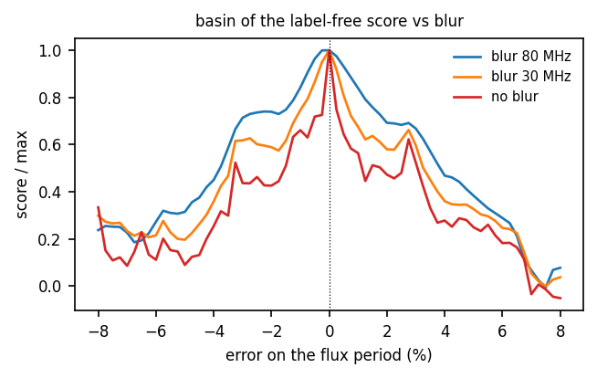
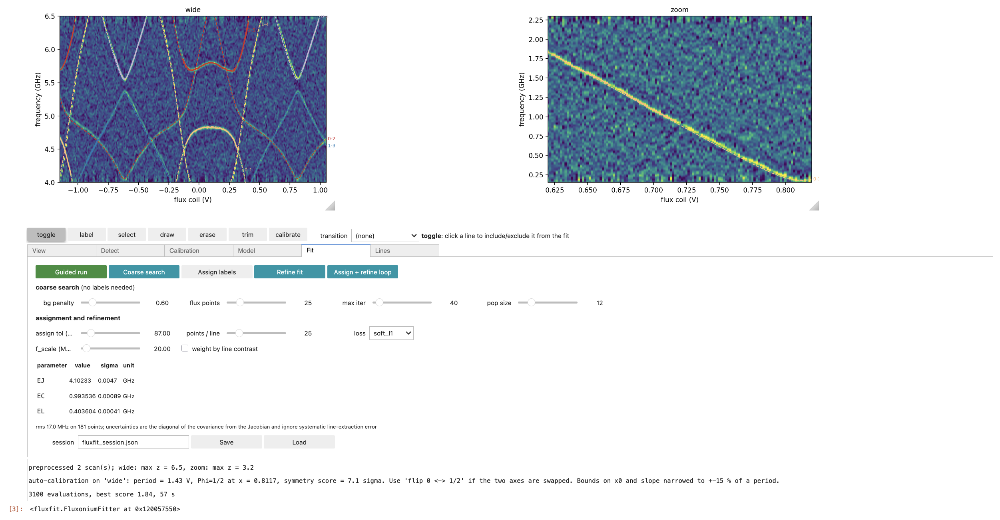

# FluxFit

**Fluxonium spectroscopy fitting in a Jupyter notebook, on top of
[scqubits](https://github.com/scqubits/scqubits).**

Give it one or more two-dimensional two-tone scans (drive frequency versus coil value),
press a few buttons, and get `E_J`, `E_C`, `E_L`, optionally `E_osc` and `g`, with
uncertainties. The lines are found for you; you click only to correct.



*From raw data to a fitted model: (a) raw magnitude, (b) the robust z-score map used by
every later stage, (c) lines tracked automatically with no user input, (d) labelled
lines and the fitted model.*

---

## What it is for

Fitting a fluxonium spectrum usually means clicking along every line of every scan, then
telling the fitter which line is which. `fluxfit` was written to remove most of that
work for one specific circuit family:

- **Lines are detected automatically.** The tool tracks whole lines across all columns of
  the image in one pass, rather than asking you to pick points. Faint lines are picked up
  by an optional ridge filter. You interact with lines, not points: click one to include
  it, exclude it, trim it, delete it, or give it a transition label.
- **Several scans at once.** A wide high-frequency scan and a low-frequency zoom around
  half flux are fitted together, sharing one set of circuit parameters. This matters
  because the wide scan constrains the level structure while the zoom pins the minimum of
  the 0-1 transition.
- **Experimental drift between scans is handled.** Scans taken in different runs are
  displaced in coil value. Each scan carries its own offset `dx`, fitted or set by
  clicking, with one reference scan holding `dx = 0`. On a real device this offset came
  out at 21 mV, which was 0.065 Phi_0 and would otherwise have ruined the joint fit.
- **A starting point without labels.** Before anything is labelled, a global search
  compares the model to the image directly by integrating the measured signal along every
  predicted transition. It replaces fitting-by-eye in the cases where it works, and the
  sliders are still there for the cases where it does not.
- **Everything is scriptable.** The widget interface is a thin layer over plain functions,
  so a fit can be run headless or looped over many devices.

> This library was vibe-coded with Claude (Anthropic). The physics requirements, the
> interface design and the acceptance criteria were specified by the author; the
> implementation, the debugging and the benchmarks reported below were produced by the
> model and checked against real and synthetic data. It has not had the review a mature
> package receives. Read [Known limitations](#known-limitations) before trusting a number
> from it.

---

## Prerequisites

| package | why | tested with |
|---|---|---|
| `python` | | 3.12 |
| `numpy` | arrays | 2.4 |
| `scipy` | peak finding, optimisers, interpolation | 1.17 |
| `matplotlib` | all plotting | 3.10 |
| `scikit-image` | Meijering ridge filter for faint lines | 0.26 |
| `scqubits` | the physics: fluxonium operators and spectra | 4.3 |
| `ipywidgets` | the controls | 8.1 |
| `ipympl` | clickable matplotlib canvases inside Jupyter | 0.10 |

```bash
pip install numpy scipy matplotlib scikit-image scqubits ipywidgets ipympl
```

`ipympl` is not optional: without `%matplotlib widget` the canvases are static images and
no click does anything. The tool raises a clear error if the backend is wrong.

There is no package to install. Drop `fluxfit.py` next to your notebook.

```python
%matplotlib widget
from fluxfit import Scan, FluxoniumFitter

scans = [Scan("wide", x=coil_V,  f=freq_GHz,  z=S21_wide),
         Scan("zoom", x=coil_V2, f=freq_MHz2, z=S21_zoom, f_unit="MHz")]
app = FluxoniumFitter(scans, with_resonator=False)
app.show()
```

`z` may be complex, of shape `(n_f, n_x)` or its transpose. Frequencies may be given in
`GHz`, `MHz`, `kHz` or `Hz`. Use `x_unit="Phi0"` if your x axis is already in flux quanta.

Start with [`demo.ipynb`](demo.ipynb), which builds a synthetic device and walks through
the whole procedure with the answer known.

---

## How does it work

The model is a fluxonium, optionally coupled to one harmonic mode:

```
H = 4 E_C n^2 + E_L phi^2 / 2 - E_J cos(phi + 2 pi Phi/Phi_0)
    + E_osc a^dag a + g n (a + a^dag)
```

built from scqubits operators. The flux axis is
`Phi/Phi_0 = slope * (x - dx_scan - x0)`.

Four stages, deliberately separated because they fail in different ways:

**1. Preprocessing.** The raw data becomes a dimensionless robust z-score map: the slow
baseline of each column is removed with a median filter along frequency, and the result is
divided by a robust estimate of the noise. Detection thresholds are then in units of the
noise standard deviation and transfer between scans taken at different drive powers.

**2. Calibration from the symmetry of the image.** The flux period comes from the
autocorrelation of the map along the coil axis, and the mirror axes from the correlation
of the map with its own reflection. No Hamiltonian is involved, so this works before you
know anything about the device. It is a heuristic: see the limitations.

**3. Line detection.** Per column, peaks are located with `scipy.signal.find_peaks` and
refined to sub-pixel accuracy by a parabolic fit. Tracks are then extended column by
column: the next frequency is predicted from a linear fit to the last few points, and
predictions are matched to peaks by a Hungarian assignment with a gate. An optional
Meijering ridge filter runs first when lines are faint.



*A line with a charge matrix element of 0.062 and a peak significance of 2.7 sigma.
Column peak finding returns fragments; the ridge filter with a length cut returns one
continuous trace.*

**4. Fitting.** Two different criteria, used in sequence.

*Label-free global search.* Every predicted transition is traced through the image and the
significance underneath it is summed, weighted by the charge matrix element `|<i|n|j>|`
and penalised per sampled point so that a line sitting on background is a net loss. No
detected lines and no labels are needed, so faint lines contribute even when they were
never detected. Differential evolution maximises this over `E_J`, `E_C`, `E_L`.

*Least squares on labelled points.* Each trace is assigned the transition with the
smallest median distance to it, and `scipy.optimize.least_squares` with a soft-L1 loss
refines the parameters. Uncertainties come from the Jacobian, and its condition number is
reported: the usual failure is not a bad optimiser but too few distinct transitions.

Three things were needed to make the global search work, each fixing a measured failure:

- **A blur schedule.** With 10 MHz lines, a 2.5 % error on the flux period displaces a
  predicted line by hundreds of MHz at the edges of a wide scan, so the score has no
  gradient there. It is evaluated on the map blurred by 80 MHz, then 30 MHz, then
  unblurred.

  

  *The unblurred score has local maxima that trap an optimiser; blurring removes them.*

- **A blur along flux too.** Sampling a predicted line at 21 points across a 500-column
  scan means a sample either lands on a line pixel or misses it. The score changed by a
  factor of 7 between 21 and 25 samples before this was fixed, and the optimiser was
  chasing sampling alignments rather than agreement with the data.

- **Staging.** A joint search over the energies and the calibration failed after 6500
  evaluations. The global stage now runs over the energies only, with the calibration held
  at its symmetry-derived value; the same problem then converged in 3325 evaluations.

Under the hood, scqubits' `Fluxonium.hamiltonian()` rebuilds the whole matrix at every
flux value, while flux enters only through `cos(phi + 2 pi f)`. `fluxfit` asks scqubits
once for the flux-independent matrices and recombines them, which reproduces
`Fluxonium.hamiltonian()` to 1.4e-14 GHz and runs 8.8 times faster (0.51 ms against
4.5 ms per flux value at cutoff 110). The spectrum is also folded onto `[0, 1/2]` and
duplicate flux values are removed before any diagonalisation.

---

## Step by step

### 1. Load your scans and open the tool

```python
app = FluxoniumFitter(scans, with_resonator=False)
app.show()
```

Two panels appear, one per scan, above a row of mode buttons and a set of tabs.



### 2. Preprocess (View tab)

Choose the signal component and press **Apply / preprocess**. You want your lines to
appear as bright maxima. If they are dark, set *peaks* to `negative`. Check *remove
flux-independent bg* only for scans that span a good fraction of a flux period, since it
also removes a nearly flat line in a narrow zoom.

### 3. Calibrate (Calibration tab)

Press **Auto-calibrate**, then look at the result. Two things go wrong often enough that
there are buttons for them: if `Phi = 0` and `Phi = 1/2` came out swapped, press **flip 0
<-> 1/2**; if the model lines are twice too dense or twice too sparse in flux, press
**period x 2** or **period / 2**.

To set the calibration by hand, choose what a click means, switch to `calibrate` mode and
click on a panel. The useful combination with a low-frequency zoom: take the period from
the wide scan's symmetry, then click the minimum of the 0-1 line with **Phi = 1/2 (keep
period)**, which moves only the offset.

A click calibrates the scan it was made in: `x0` in the reference scan, and that scan's
own `dx` in any other.

### 4. Set bounds and run the coarse search (Model and Fit tabs)

Set bounds on `E_J`, `E_C`, `E_L` that you actually believe; the defaults are wide enough
to be slow. Dragging the sliders with the overlay on for thirty seconds is a good way to
check the regime before searching.

Press **Coarse search** and judge the result on the overlay, not on the score. If the
model matches near half flux but drifts at the edges, the flux period is wrong.

### 5. Detect lines (Detect tab)

Press **Detect (all)** at a threshold around 3 sigma. Then zoom onto any faint branch that
was missed, lower the threshold, and press **Detect in view**, which only looks inside the
current axes limits. For the faintest lines, tick **ridge filter** and raise *min length*
to around 30 to remove the spurious short segments it produces.

### 6. Curate by clicking

| mode | a left click does |
|---|---|
| `toggle` | include or exclude the line from the fit |
| `label` | give the line the transition chosen in the dropdown next to the mode buttons |
| `select` | select a line so its numbers show in the Lines tab |
| `draw` | add a point; after three or four points press **Finish line** and each column is snapped to the local maximum |
| `erase` | delete the line |
| `trim` | cut the line at that flux, on the side nearer the click |
| `calibrate` | set the flux reference chosen in the Calibration tab |

A label set by hand is marked `*` in the Lines tab and the automatic assignment will not
overwrite it. Press **unlock hand labels** to release them.

### 7. Assign and refine (Fit tab)

Press **Assign + refine loop**, which alternates assignment and refinement with a
tightening tolerance. A single pass is usually not enough: from a hand-set starting point
on a real dataset, one pass at 50 MHz labelled 3 of 15 traces, while the loop starting at
150 MHz labelled 15 of 15.

Then read the Lines tab. `conf` is the ratio of the second-best to the best branch
distance, so a value near 1 means the label is a coin flip; fix those by hand and refine
again.

`x0`, `slope` and the offsets `dx` start **fixed**, because the calibration comes from the
Calibration tab. Tick them only as a final check once the fit is converged.

### 8. Save

```python
app.save("device_A.json")    # parameters, bounds, traces, labels; not the raw data
```

### Control reference

| tab | control | what it does |
|---|---|---|
| View | signal | which component of a complex `z` to use: `abs`, `logabs`, `re`, `im`, `phase`, `dphase` |
| View | peaks | whether lines are maxima, minima, or either, in the processed map |
| View | noise est. | `global` (one noise scale for the map) or `column` (one per flux value). Keep `global` unless the noise genuinely varies with flux |
| View | remove flux-independent bg | subtract the median along flux at each frequency |
| View | detrend f | window of the median filter that removes each column's baseline, as a fraction of the frequency span. Disabled automatically below 9 points |
| View | smooth f, smooth x | Gaussian blur in pixels |
| View | colour %, cmap | display only |
| View | label the model lines | write the transition name at the end of each model curve |
| Detect | threshold (sigma) | peak prominence in units of the noise standard deviation |
| Detect | min length | discard traces shorter than this, in columns |
| Detect | max gap | how many columns a track may lose before it is closed. Lower it near an anticrossing so tracks do not jump branches |
| Detect | link tol | matching window around the slope-extrapolated prediction; 0 means 6 frequency pixels |
| Detect | peaks / column | cap on peaks kept per column, strongest first |
| Detect | smooth line | median filter along the extracted trace, in points |
| Detect | ridge filter | Meijering pre-filter for faint lines |
| Detect | snap (MHz) | half-width of the snap window used by `draw` |
| Calibration | reference | which scan defines the common flux axis, with `dx = 0` |
| Calibration | click sets | what a `calibrate` click means |
| Calibration | Auto-calibrate | period and mirror axes from the image symmetry |
| Calibration | flip, period x2, /2 | fix the two common aliases |
| Model | couple a resonator | add `E_osc` and `g` |
| Model | fluxonium / resonator levels, cutoff | truncation |
| Model | also transitions from \|1> | include 1-to-j lines, visible through thermal population |
| Model | two-photon lines | draw transitions at f/2 |
| Model | min \|<i\|n\|j>\| | hide transitions weaker than this |
| Model | model points | flux resolution of the overlay |
| Model | live update | redraw while dragging a slider instead of on release |
| Model | the parameter rows | value, slider, free/fixed checkbox, bounds |
| Fit | bg penalty | cost per sampled point of the global score; raise it if the search finds dense spurious solutions |
| Fit | flux points | samples per predicted line per scan in the global score |
| Fit | max iter, pop size | differential-evolution budget |
| Fit | assign tol | maximum median distance for a label to be accepted |
| Fit | points / line | decimation of each trace before fitting |
| Fit | loss, f_scale | robust loss and the residual scale where it starts down-weighting |
| Fit | weight by line contrast | weight points by the square root of their peak prominence |
| Fit | Guided run | preprocess, calibrate, coarse search, detect, assign and refine in one press |
| Lines | the rows | inclusion, selection, deletion, label, `conf`, residual |

---

## Results

### Reproducible: the synthetic device in `demo.ipynb`

A synthetic fluxonium at `E_J = 4.1 GHz`, `E_C = 1.0 GHz`, `E_L = 0.4 GHz`, with 12 MHz
lines, a 3 MHz per column random walk of each line, 15 % of the lines attenuated, and a
peak signal-to-noise ratio of 8. Two scans: 4.0 to 6.5 GHz over 1.5 flux periods, and a
low-frequency zoom around half flux. Starting from `E_J = 5.0`, `E_C = 1.3`, `E_L = 0.8`
and an unknown flux calibration:

| quantity | fitted | sigma | true | deviation |
|---|---|---|---|---|
| E_J | 4.0961 GHz | 0.0049 | 4.1 | -0.10 % |
| E_C | 0.9965 GHz | 0.0012 | 1.0 | -0.35 % |
| E_L | 0.4024 GHz | 0.0006 | 0.4 | +0.61 % |

Flux period recovered to 0.1 %; 11 of 11 detected lines labelled, carrying five
transitions (0-1, 0-2, 0-3, 1-3, 1-5); rms residual 20.5 MHz over 218 points; Jacobian
condition number 13. Total runtime 51 s on one core, of which 47 s is the global search.

Note that the deviations are several times the quoted `sigma`. That is expected and is
discussed below.

### A real device

The same procedure on a measured fluxonium, from a wide scan (4.29 to 7.03 GHz, 500 coil
values, about 1.5 flux periods) and a low-frequency zoom (180 to 194 MHz, 15 frequency
points) recorded in a separate run:

`E_J = 4.176 +- 0.003 GHz`, `E_C = 0.9359 +- 0.0005 GHz`, `E_L = 0.5126 +- 0.0005 GHz`,
coil offset of the zoom 21.3 mV (0.065 Phi_0), rms residual 13.6 MHz over 366 points from
15 lines carrying four transitions, Jacobian condition number 15. The manual work was one
drawn line, one label, and a press of *flip*.

The dataset is not included in this repository, so these numbers cannot be reproduced from
it; they are quoted because a synthetic benchmark says nothing about frequency jitter,
two-level-system defects, drifting backgrounds or drive-power artefacts, and this is the
evidence that the tool works on data that has all of those.

**On the uncertainties.** The `sigma` above are the diagonal of the covariance from the
Jacobian. They describe the scatter of the extracted points about the model, not the bias
of the line extraction, and they underestimate the true error by roughly an order of
magnitude: in one synthetic test the deviation was 6.6 sigma. Quote a systematic floor of
about 1 %, or estimate it by refitting with different detection settings and taking the
spread.

---

## Known limitations

- **Fluxonium only**, plus at most one harmonic mode. No transmons, no flux qubits, no
  0-pi, no custom circuits, no multi-qubit Hilbert spaces, no flux crosstalk between
  several loops. Use [qfit](https://github.com/scqubits/qfit) for any of those.
- **The label-free global search is the least reliable part.** It needs several distinct
  branches inside the measured window. On a synthetic scan covering 4.0 to 6.5 GHz it
  converged to within 0.4 % of the truth; with the window narrowed to 4.0 to 5.4 GHz,
  where only four transitions enter, it returned `E_J = 6.7 GHz` against a true 4.1 GHz.
  The score at the true parameters was higher than at the returned solution (0.86 against
  0.52), so the criterion is right and the search is what failed. Always judge it on the
  overlay.
- **The symmetry calibration aliases.** Symmetry axes recur every half period, so the
  autocorrelation can lock onto half the true period: on one synthetic dataset it returned 0.733 units
  against a true 1.429. The `Phi = 0` against `Phi = 1/2` assignment is also frequently
  wrong. Hence the *flip* and *period x2* buttons.
- **Do not free the calibration together with the energies** before the labels are stable.
  From a converged fit on real data, releasing everything at once gave an rms residual of
  1052 MHz and a condition number of 1.6e7, against 13.6 MHz and 15 with the calibration
  held.
- **`g` is biased by the line extraction.** It is set by the avoided crossing, which is
  exactly where the tracker tends to follow the diabatic line across the gap. On synthetic
  data with `g = 0.120 GHz` the automatic chain returned `0.102 +- 0.005 GHz`, a 15 %
  error, while `E_J`, `E_C`, `E_L` and `E_osc` came back within 0.05 %. Trim the traces on
  either side of the crossing if `g` matters.
- **Performance is untested at scale.** Interactive redraw has been exercised on scans up
  to 500 by 300 points. There is no blitting; sliders update on release by default.

---

## Relation to qfit and scqubits

[qfit](https://github.com/scqubits/qfit) solves
the same problem for a much wider class of circuits, with a packaged Qt application,
assisted flux crosstalk calibration across several loops, computer-assisted point
extraction, interactive pre-fit and automated fitting. If you work with anything other
than a fluxonium, or with several coupled loops, use qfit.

`fluxfit` differs in being narrower and in a few specific choices: line tracking across all
columns instead of point extraction, a global search that needs no labels, calibration
from image symmetry, per-scan coil offsets for drift, and a notebook rather than an
application. Those ideas are free to be reused or reimplemented in qfit, where they would
reach far more users and circuit types.

The physics is entirely scqubits. `fluxfit` is a thin layer on top of it and would not
exist without it.

---

## Attribution

If this tool is useful in work you publish, please cite scqubits, which does the physics:

> Peter Groszkowski and Jens Koch,
> *scqubits: a Python package for superconducting qubits*,
> Quantum **5**, 583 (2021).
> https://quantum-journal.org/papers/q-2021-11-17-583/

> Sai Pavan Chitta, Tianpu Zhao, Ziwen Huang, Ian Mondragon-Shem, and Jens Koch,
> *Computer-aided quantization and numerical analysis of superconducting circuits*,
> New J. Phys. **24**, 103020 (2022).
> https://iopscience.iop.org/article/10.1088/1367-2630/ac94f2

and, if you also used qfit or took ideas from it:

> https://github.com/scqubits/qfit

For this repository, a mention in the acknowledgements or a link is enough:

```bibtex
@software{FluxFit,
  author  = {Adria Rospars},
  title   = {FluxFit: automatic line extraction and fitting of fluxonium spectra},
  year    = {2026},
  url     = {https://github.com/AdRs21/fluxfit},
  note    = {Built on scqubits; developed with the assistance of a large language model}
}
```

## License

[](http://en.wikipedia.org/wiki/BSD_licenses#3-clause_license_.28.22Revised_BSD_License.22.2C_.22New_BSD_License.22.2C_or_.22Modified_BSD_License.22.29)

You are free to use this software, with or without modification, provided that the conditions listed in the `LICENSE` file are satisfied.
